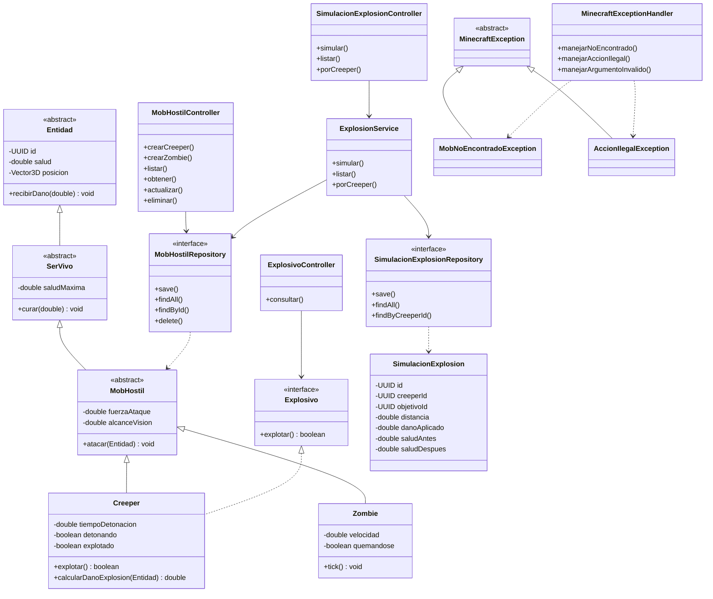

# NRodriguez-taller-git-2026
Taller Git 2026 - Modelado POO Minecraft con Spring Boot

## Diagrama de clases del modelo Minecraft

Diagrama generado a partir del código real ubicado en `src/main/java/py/edu/uc/lp3/`, con las clases del dominio en `minecraft/` y los controladores REST en `rest/controller/`.

### Herencia

`Entidad` es la clase abstracta raíz del modelo. De ella derivan `SerVivo` (salud máxima, veneno y regeneración), `Animal` (edad y domesticación) y `Residente` (posibilidad de comerciar).

De `SerVivo` derivan `Jugador` y la clase abstracta `MobHostil`. Los mobs hostiles concretos son `Zombie`, `Esqueleto`, `Creeper`, `Enderman` y `Ghast` (contribución fusionada).

De `Animal` deriva `Cerdo`, y de `Residente` deriva `Aldeano`.

### Composición y asociaciones

- `Jugador` mantiene una relación de **composición** con `Inventario` (capacidad 36).
- `Inventario` agrega **0..*** objetos de tipo `Item`.
- `Entidad` usa `Vector3D` para su posición y `TipoEntidad` para su tipo.
- `Bloque` es una clase independiente que también usa `Vector3D`.
- Asociaciones de uso: `Jugador.atacar(Entidad)`, `Jugador.colocarBloque(Bloque)`, `MobHostil.atacar/buscarObjetivo(Entidad)`, `Enderman.tomarBloque(Bloque)`, `Animal.alimentar(Item)`, `Residente.interactuar(Jugador)`, `Aldeano.comerciar(Jugador, Item)`.

### Comportamiento polimórfico `emitirSonido()`

`emitirSonido()` se declara abstracta en `Entidad`, se implementa genéricamente en `SerVivo` y se **sobrescribe** de forma polimórfica en `Zombie` (ej. "Grrr..."), `Cerdo` ("Oinc oinc") y `Aldeano` ("Hmm... ¿En qué puedo ayudarte?").
### Sobrecarga y sobreescritura

En esta revisión se agregó sobrecarga en la clase `Creeper`.

- Se agregó un constructor simple `Creeper(Vector3D posicion)`.
- Se agregó un constructor sobrecargado `Creeper(Vector3D posicion, double tiempoDetonacion)`.
- También se sobrecargó el método `acercarse`, permitiendo usarlo con solo el objetivo o con un objetivo y una distancia máxima.

La sobreescritura ya estaba presente mediante métodos con `@Override`. Por ejemplo, `Creeper` y `Zombie` redefinen `tick()`, y `Zombie` redefine `emitirSonido()`.

La diferencia es que la sobrecarga mantiene el mismo nombre pero cambia los parámetros, mientras que la sobreescritura redefine en una clase hija un método heredado de una clase padre.
### Diagrama Mermaid

```mermaid
classDiagram
    class TipoEntidad {
        <<enumeration>>
        JUGADOR
        ZOMBIE
        ESQUELETO
        CREEPER
        ENDERMAN
        GHAST
        CERDO
        ALDEANO
        OTRO
    }

    class Vector3D {
        -double x
        -double y
        -double z
        +getX() double
        +getY() double
        +getZ() double
        +distanciaA(otro Vector3D) double
    }

    class Entidad {
        <<abstract>>
        -UUID id
        -TipoEntidad tipo
        -String nombre
        -double salud
        -Vector3D posicion
        +getSalud() double
        +getPosicion() Vector3D
        +recibirDano(cantidad double) void
        +curar(cantidad double) void
        +estaViva() boolean
        +moverse(destino Vector3D) void
        +tick()*
        +emitirSonido()*
        #cambiarSalud(nuevaSalud double) void
    }

    class SerVivo {
        <<abstract>>
        -double saludMaxima
        -boolean envenenado
        -double regeneracion
        +getSaludMaxima() double
        +estaEnvenenado() boolean
        +envenenar() void
        +curarEnvenenamiento() void
        +aplicarRegeneracion(cantidadPorTick double) void
        +curar(cantidad double) void
        +tick() void
        +emitirSonido() String
    }

    class Jugador {
        -String nombreJugador
        -Inventario inventario
        -int nivelExperiencia
        -boolean modoCreativo
        +getNombreJugador() String
        +getNivelExperiencia() int
        +esModoCreativo() boolean
        +setModoCreativo(modoCreativo boolean) void
        +aumentarExperiencia(cantidad int) void
        +atacar(objetivo Entidad) void
        +recoger(item Item) boolean
        +colocarBloque(bloque Bloque) void
        +abrirInventario() Inventario
    }

    class MobHostil {
        <<abstract>>
        -double fuerzaAtaque
        -double alcanceVision
        +getFuerzaAtaque() double
        +getAlcanceVision() double
        +buscarObjetivo(entidades List~Entidad~) Entidad
        +atacar(objetivo Entidad) void
    }

    class Zombie {
        -double velocidad
        -boolean quemandose
        +getVelocidad() double
        +estaQuemandose() boolean
        +exponerAlSol(expuesto boolean) void
        +emitirSonido() String
        +tick() void
    }

    class Esqueleto {
        -boolean conArco
        +tieneArco() boolean
        +dispararFlecha(objetivo Entidad) boolean
    }

    class Creeper {
        -double tiempoDetonacion
        -boolean detonando
        -boolean explotado
        +getTiempoDetonacion() double
        +estaDetonando() boolean
        +comenzarDetonacion() void
        +Creeper(posicion Vector3D)
        +Creeper(posicion Vector3D, tiempoDetonacion double)
        +acercarse(objetivo Entidad) void
        +acercarse(objetivo Entidad, distanciaMaxima double) void
        +explotar() boolean
        +tick() void
    }

    class Enderman {
        +teletransportarse(destino Vector3D) void
        +tomarBloque(bloque Bloque) Bloque
    }

    class Ghast {
        -int ticksEnfriamientoAtaque
        +getTicksEnfriamientoAtaque() int
        +puedeAtacar() boolean
        +atacar(objetivo Entidad) void
        +tick() void
    }

    class Animal {
        <<abstract>>
        -int edad
        -boolean domesticable
        +getEdad() int
        +esAdulto() boolean
        +esDomesticable() boolean
        +alimentar(alimento Item)*
        +tick() void
    }

    class Cerdo {
        -boolean montable
        +esMontable() boolean
        +emitirSonido() String
        +alimentar(alimento Item) boolean
    }

    class Residente {
        <<abstract>>
        -boolean puedeComerciar
        +puedeComerciar() boolean
        +interactuar(jugador Jugador)*
        +tick() void
    }

    class Aldeano {
        -String profesion
        -int nivelComercio
        +getProfesion() String
        +setProfesion(profesion String) void
        +getNivelComercio() int
        +comerciar(jugador Jugador, item Item) boolean
        +emitirSonido() String
        +interactuar(jugador Jugador) void
    }

    class Inventario {
        -int capacidadMaxima
        -List~Item~ items
        +agregar(item Item) boolean
        +quitar(item Item) boolean
        +estaLleno() boolean
        +getCapacidadMaxima() int
        +getItems() List~Item~
    }

    class Item {
        -UUID id
        -String nombre
        +getId() UUID
        +getNombre() String
    }

    class Bloque {
        -String material
        -Vector3D posicion
        +getMaterial() String
        +getPosicion() Vector3D
    }

    Entidad <|-- SerVivo : extends
    SerVivo <|-- Jugador : extends
    SerVivo <|-- MobHostil : extends
    MobHostil <|-- Zombie : extends
    MobHostil <|-- Esqueleto : extends
    MobHostil <|-- Creeper : extends
    MobHostil <|-- Enderman : extends
    MobHostil <|-- Ghast : extends
    Entidad <|-- Animal : extends
    Animal <|-- Cerdo : extends
    Entidad <|-- Residente : extends
    Residente <|-- Aldeano : extends

    Jugador *-- Inventario : composicion
    Inventario o-- Item : 0..*

    Entidad --> Vector3D : posicion
    Entidad --> TipoEntidad : tipo
    Bloque --> Vector3D : posicion
    Jugador --> Entidad : atacar
    Jugador --> Item : recoger
    Jugador --> Bloque : colocarBloque
    MobHostil --> Entidad : atacar / buscarObjetivo
    Esqueleto --> Entidad : dispararFlecha
    Creeper --> Entidad : acercarse
    Enderman --> Bloque : tomarBloque
    Enderman --> Vector3D : teletransportarse
    Animal --> Item : alimentar
    Residente --> Jugador : interactuar
    Aldeano --> Jugador : comerciar
    Aldeano --> Item : comerciar
```---

# POO-08 — CRUD REST, H2 y simulación de explosiones

## Objetivo

Ampliar el modelado de Minecraft desarrollado en los ejercicios anteriores para ofrecer un servicio HTTP con Spring Boot, persistencia mediante H2, operaciones CRUD REST y una simulación de explosiones.

El proyecto conserva la herencia, el polimorfismo, los constructores sobrecargados y los comportamientos del dominio.

## Tecnologías

- Java 21
- Spring Boot 4.0.8
- Spring Web MVC
- Spring Data JPA / Hibernate
- H2 Database
- Maven Wrapper
- Insomnia para probar los endpoints

## Cómo ejecutar

Desde la raíz del repositorio:

```bash
./mvnw spring-boot:run
```

En Windows, desde PowerShell:

```powershell
.\mvnw.cmd spring-boot:run
```

El servidor se inicia en `http://localhost:8080`.

El endpoint `GET /` permite comprobar que la aplicación está activa.

Para ejecutar las pruebas automatizadas:

```bash
./mvnw clean test
```

## Configuración y persistencia H2

La configuración está en `src/main/resources/application.properties`.

| Propiedad | Explicación |
|---|---|
| `spring.application.name` | Identifica la aplicación Spring Boot. |
| `spring.datasource.url=jdbc:h2:file:./data/minecraft` | Guarda la base H2 en archivos locales para conservar datos entre reinicios. |
| `spring.datasource.driver-class-name=org.h2.Driver` | Configura el controlador JDBC de H2. |
| `spring.datasource.username=sa` | Usuario de desarrollo de la base. |
| `spring.datasource.password=` | Contraseña vacía para el entorno local. |
| `spring.jpa.hibernate.ddl-auto=update` | Hibernate crea o actualiza el esquema sin borrar automáticamente los registros existentes. |
| `spring.jpa.show-sql=true` | Muestra las sentencias SQL generadas. |
| `spring.h2.console.enabled=true` | Habilita la consola H2 para desarrollo. |
| `spring.h2.console.path=/h2-console` | Establece la ruta de la consola H2. |
| `server.port=8080` | Define el puerto del servicio HTTP. |

La consola está disponible en `http://localhost:8080/h2-console`.

Para conectarse, utilizar la URL JDBC `jdbc:h2:file:./data/minecraft`, usuario `sa` y contraseña vacía. La aplicación debe ejecutarse desde la raíz del repositorio.

La carpeta `data/` está excluida de Git. Cada persona genera su propia base local.

## Familia persistida

Se utiliza una jerarquía de tres clases:

- `MobHostil`: clase padre abstracta y entidad JPA.
- `Creeper`: clase hija con detonación y explosión.
- `Zombie`: clase hija con comportamientos de daño y exposición al sol.

La estrategia JPA es `SINGLE_TABLE`. La tabla `mob_hostil` conserva los atributos de ambas clases hijas y utiliza `clase_mob` como discriminador.

Las clases `Entidad` y `SerVivo` están marcadas como `@MappedSuperclass`, permitiendo heredar sus atributos persistentes.

También se guarda `SimulacionExplosion`, que registra el historial de explosiones.

## Diagrama Mermaid de POO-08



## Endpoints REST

### CRUD de mobs

| Método | URL | Descripción |
|---|---|---|
| POST | `/api/minecraft/mobs/creepers` | Crear Creeper |
| POST | `/api/minecraft/mobs/zombies` | Crear Zombie |
| GET | `/api/minecraft/mobs` | Listar mobs persistidos |
| GET | `/api/minecraft/mobs/{id}` | Consultar mob |
| PUT | `/api/minecraft/mobs/{id}` | Actualizar posición y salud |
| DELETE | `/api/minecraft/mobs/{id}` | Eliminar mob |

### Interface y simulaciones

| Método | URL | Descripción |
|---|---|---|
| GET | `/api/minecraft/explosivos/{id}` | Consultar capacidad Explosivo |
| POST | `/api/minecraft/simulaciones/explosiones` | Ejecutar y guardar explosión |
| GET | `/api/minecraft/simulaciones/explosiones` | Consultar historial |
| GET | `/api/minecraft/simulaciones/explosiones/creeper/{id}` | Consultar explosiones de un Creeper |

## Reglas de negocio

**Regla 1 — Detonación:** un Creeper solo puede explotar si está vivo, inició su detonación y todavía no explotó.

**Regla 2 — Daño por distancia:** una explosión causa un daño decreciente hasta un radio máximo de cuatro bloques; fuera del radio el daño es cero y la salud nunca puede ser negativa.

La fórmula simplificada es:

`daño = 17 × (1 - distancia / 4)`

Se aplica únicamente cuando la distancia es menor o igual a cuatro bloques.

La simulación registra los identificadores del Creeper y el objetivo, la distancia, el daño real aplicado y la salud anterior y posterior.

La operación se ejecuta dentro de una transacción para guardar conjuntamente el cambio de estado y el historial.

## Invariantes del dominio

- La salud no puede ser negativa ni superar la salud máxima.
- Los valores numéricos del dominio deben ser finitos.
- El tiempo inicial de detonación debe ser positivo.
- Un Creeper muerto no puede explotar.
- Un Creeper no puede detonar dos veces.
- El objetivo de la simulación debe existir y estar vivo.
- Un Creeper no puede ser su propio objetivo.
- Una explosión inválida no debe crear un registro de simulación.

Los atributos permanecen encapsulados y los cambios se realizan mediante constructores y métodos del dominio.

## Excepciones y HTTP

La jerarquía está formada por `MinecraftException` y sus hijas:

| Excepción | HTTP | Motivo |
|---|---|---|
| `MobNoEncontradoException` | 404 Not Found | El UUID solicitado no existe. |
| `AccionIlegalException` | 409 Conflict | La acción contradice el estado del juego. |

Además, `IllegalArgumentException` se maneja como HTTP 400 para argumentos inválidos.

El `MinecraftExceptionHandler` utiliza `@RestControllerAdvice` y devuelve un JSON con `status`, `error`, `mensaje` y `fecha`.

## Respuestas a "Qué hay que pensar"

### 1. Recurso y verbo

El recurso principal es `mob`. La URL identifica la colección o un mob mediante su UUID. Los verbos HTTP indican si se crea, consulta, actualiza o elimina.

### 2. Identidad

La clave es `UUID id`, creada por el constructor del dominio. El JSON de creación no incluye el identificador: la respuesta HTTP devuelve el UUID asignado.

### 3. Herencia y tablas

Se eligió `SINGLE_TABLE` porque Creeper y Zombie comparten los atributos de MobHostil. La columna `clase_mob` identifica el subtipo en H2 y el campo `tipo` permite distinguirlo en el JSON. Se utilizaron URLs específicas para crear cada subtipo.

### 4. Interfaz y repositorio

`MobHostilRepository` extiende `JpaRepository`, de modo que el controlador depende de una abstracción y Spring Data genera las operaciones de persistencia.

Esto se relaciona con POO-07 porque una interfaz define un contrato sin obligar al consumidor a conocer su implementación.

### 5. Protocolo del dominio

La interfaz `Explosivo` declara `explotar()` y está implementada por Creeper. El endpoint `GET /api/minecraft/explosivos/{id}` comprueba si el mob implementa ese contrato y devuelve su capacidad actual de explotar.

Actualmente se aplica a Creeper, no a otras familias del modelo.

### 6. Ocultamiento

Las reglas numéricas pertenecen a las clases del dominio. Un POST de Creeper con tiempo de detonación negativo debe devolver HTTP 400 y no crear el registro. Una simulación inválida devuelve HTTP 409 y no agrega una explosión al historial.

### 7. PUT y PATCH

Se implementó PUT para actualizar el subconjunto de posición y salud, no para reemplazar todos los atributos de la entidad. Los campos numéricos omitidos en el cuerpo actual pueden recibir el valor predeterminado cero, por lo que el cliente debe enviar todos los campos requeridos.

### 8. DELETE

Eliminar significa retirar el mob de la base de datos mediante el repositorio. Primero se busca el objeto y después se llama a `delete`. Si no existe, devuelve HTTP 404; si se elimina, responde HTTP 204.

### 9. Dos reglas

La primera regla determina cuándo puede explotar un Creeper y la segunda calcula el daño por distancia al objetivo. El recurso HTTP es `/api/minecraft/simulaciones/explosiones`. Un GET posterior devuelve el historial guardado y permite comprobar la salud persistida del objetivo.

### 10. Excepciones

`MinecraftException` es la excepción base. `MobNoEncontradoException` representa un recurso inexistente y `AccionIlegalException` una acción prohibida por el estado del juego. Son errores distintos y reciben handlers HTTP separados con un JSON explicativo.

## Colección de Insomnia

La colección está almacenada en:

`insomnia/POO08-Minecraft.postman_collection.json`

Es un archivo de colección Postman v2.1 compatible con la importación de Insomnia.

### Cómo importar

1. Abrir Insomnia.
2. Seleccionar Import y luego File.
3. Elegir el archivo JSON del repositorio.
4. Confirmar la importación.
5. Comprobar que la variable `baseUrl` apunte a `http://localhost:8080/api/minecraft`.

### Orden recomendado de prueba

1. Crear un Creeper y un Zombie.
2. Copiar los UUID devueltos a las variables `creeperId` y `zombieId`.
3. Listar y consultar los mobs.
4. Actualizar un mob y comprobar su estado.
5. Consultar el endpoint de Explosivo.
6. Ejecutar una explosión.
7. Consultar el historial y la salud restante.
8. Repetir la explosión para obtener HTTP 409.
9. Consultar un UUID inexistente para obtener HTTP 404.
10. Intentar crear un Creeper con tiempo negativo para obtener HTTP 400.
11. Eliminar los mobs de prueba.

La colección está versionada para que otro estudiante pueda repetir las peticiones sin construirlas manualmente.

## Prueba de simulación realizada

Se creó un Creeper con 20 puntos de salud en `(0,64,0)` y un Zombie con 20 puntos de salud en `(2,64,0)`.

La distancia fue de dos bloques. El daño calculado fue de 8,5 puntos y la salud del Zombie quedó en 11,5.

La simulación se guardó en H2 y posteriormente se recuperó mediante GET. Un segundo intento de explosión con el mismo Creeper devolvió HTTP 409.

## Enlace al commit de POO-08

(https://github.com/NicoRodriguez85677/NRodriguez-taller-git-2026/commit/80e4af362d5e564478206097cad6d16d6e7e00e1)
