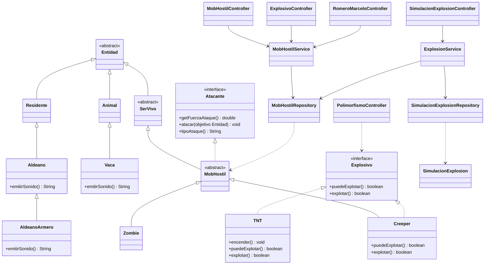

# NRodriguez-taller-git-2026
Taller Git 2026 - Modelado POO Minecraft con Spring Boot

## POO-09 — APIs cruzadas

A1 (Nicolás) valida un ataque simulado contra un Zombie. Primero consulta a
Amir (A2) con `GET /entidad/zombie?danio={danio}` y comprueba `entidad.viva`.
Si Amir acepta, consulta a Sofi (A3) con `GET /api/entidades/{objetivoId}` y
comprueba que la entidad sea un `ZOMBIE` con `salud > 0`. Un `404` de Sofi
cuenta como rechazo de A3. Las dos consultas son de lectura.

### Estado de la corrección de POO-08

La corrección de POO-08 registró 19,5/24. El estado de sus observaciones
en esta entrega es el siguiente.

| Observación | Estado |
| --- | --- |
| Paquetes de los controladores y del dominio | Cerrada. `IndexController` y `PolimorfismoController` declaran `rest.controller`. El modelo está en `py.edu.uc.lp3.domain`. |
| Acceso directo a repositorios desde los controladores | Cerrada. El CRUD y la consulta de explosivos delegan en `MobHostilService`. |
| Validaciones, reglas y excepciones en la capa de servicio | Cerrada para los flujos de POO-08. `MobHostilService` valida la entrada del CRUD y `ExplosionService` valida la detonación y calcula el daño. Se retiraron las excepciones de validación de las entidades señaladas. Los controles internos de estado conservan el comportamiento de la consulta de explosivos y de la simulación. |
| Dos implementaciones del protocolo y lectura mediante la interfaz | Cerrada. `Creeper` y `TNT` implementan `Explosivo`. El endpoint de consulta invoca `puedeExplotar()` a través de esa interfaz. |
| Sobrecarga de constructores en otra clase | Cerrada. `Zombie` tiene un constructor con posición y otro con posición y velocidad. |
| Clases ausentes del diagrama | Cerrada. El diagrama incluye a `Vaca` y `AldeanoArmero`. |


### Configuración y OpenAPI

En la terminal PowerShell desde la que se vaya a iniciar A1, con Tailscale conectado:

```powershell
$env:POO09_A2_URL = "http://100.78.121.31:8080"
$env:POO09_A3_URL = "http://100.79.75.27:8081"
.\mvnw.cmd spring-boot:run
```

Las variables se leen al iniciar. Si A1 ya está en ejecución en el puerto 8080,
coordiná el próximo arranque antes de aplicar esta configuración.

### Grupo Minecraft y OpenAPI

| Rol | Integrante | Base por Tailscale | OpenAPI | Dos reglas publicadas |
| --- | --- | --- | --- | --- |
| A1 | Nicolás Rodríguez | `http://100.83.179.97:8080` | [OpenAPI A1](http://100.83.179.97:8080/v3/api-docs) | Puede detonar un Creeper vivo que no esté detonando ni haya explotado. El daño de la explosión disminuye con la distancia y tiene un radio máximo de 4 bloques. |
| A2 | Amir | `http://100.78.121.31:8080` | [OpenAPI A2](http://100.78.121.31:8080/v3/api-docs) | El daño se aplica a una entidad temporal y su estado indica si sigue viva (`GET /entidad/{tipo}`). La previsualización de explosiones usa radio 3 y daño máximo de 20, o 40 si el Creeper está cargado, con caída lineal redondeada. |
| A3 | Sofi | `http://100.79.75.27:8081` | [OpenAPI A3](http://100.79.75.27:8081/v3/api-docs) | La validación de explosión requiere tres UUID distintos de un Creeper, un Jugador y un Cerdo, con el Creeper vivo. La simulación aplica hasta 20 puntos de daño dentro de 6 bloques y consume la salud del Creeper. |

La entrega de Nicolás consume a Amir y Sofi. El OpenAPI de Sofi también describe
una demolición coordinada que consulta a Nicolás y Amir. Las tres URLs de
OpenAPI respondieron `200` por Tailscale el 23/11/2026. Documentación interactiva en Swagger UI: [Nicolás](http://100.83.179.97:8080/swagger-ui/index.html), [Amir](http://100.78.121.31:8080/swagger-ui/index.html) y [Sofi](http://100.79.75.27:8081/swagger-ui/index.html).

Para la jugada de Nicolás, Amir simula el daño sobre un Zombie temporal. Se
consulta primero porque, si el Zombie no sobrevive, el escenario termina y no
hace falta consultar a Sofi. En Sofi, `GET /api/entidades/{id}` aporta el tipo
y la salud de la entidad registrada. A1 acepta ese objetivo solo si existe,
es Zombie y tiene salud positiva.

### Arranque desde los commits del grupo

Usá JDK 21 y ejecutá cada servicio desde la raíz de su clon. Arrancá Amir
y Sofi primero, comprobá sus OpenAPI y después arrancá A1 con las variables
de entorno indicadas arriba.

| Servicio | Repositorio | Commit de referencia | Comando | Puerto |
| --- | --- | --- | --- | --- |
| A1 · Nicolás | [Repositorio](https://github.com/NicoRodriguez85677/NRodriguez-taller-git-2026) | [`7b31bd2`](https://github.com/NicoRodriguez85677/NRodriguez-taller-git-2026/commit/7b31bd2a787cdf715a338f3db82655035f9a2751) | `./mvnw spring-boot:run` | 8080 |
| A2 · Amir | [Repositorio](https://github.com/AmirDujak/adb-taller-git-2026) | [`bd53941`](https://github.com/AmirDujak/adb-taller-git-2026/commit/bd5394196ea800c2aa751f00625944c513f4e486) | `./mvnw spring-boot:run` | 8080 |
| A3 · Sofi | [Repositorio](https://github.com/Sofia-torres00/st-taller-git-2026) | [`e79b309`](https://github.com/Sofia-torres00/st-taller-git-2026/commit/e79b309ff49796e3ba00c5e1e72870d70c0ec28c) | `./mvnw spring-boot:run` | 8081 |

Cloná cada repositorio con `git clone <URL>`, entrá en su carpeta y seleccioná
el hash de la tabla con `git switch --detach <hash>`. En Windows, usá
`.\mvnw.cmd spring-boot:run`. Si A1 y A2 corren en la misma máquina, asigná
un puerto libre a uno de ellos con `SERVER_PORT` y ajustá las bases de la
colección y de A1.

Los commits de Amir y Sofi corresponden a sus ramas `main` al consultarlas.
La evidencia por Tailscale se capturó contra las instancias activas. Si al
arrancar Sofi con una H2 nueva el UUID del Zombie de ejemplo no existe, creá
un Zombie con salud positiva mediante `POST /api/entidades` en el Swagger
de Sofi y poné el UUID devuelto en `zombieVivoSofiId` de la colección. Hacé
esa creación en una instancia de prueba de Sofi. Amir usa un Zombie temporal
para este escenario.


### Demostración

Consultá `GET /api/minecraft/mobs` en A1 y reemplazá `<UUID_CREEPER_A1>`
por el `id` de una entrada con `tipo: CREEPER`. Enviá cada cuerpo por
`POST /api/minecraft/jugadas-cruzadas` con `Content-Type: application/json`.

**Ambos aceptan · 201**

```json
{"creeperId":"<UUID_CREEPER_A1>","objetivoId":"11111111-1111-1111-1111-111111111111","danio":0}
```

**Rechaza Amir · 409 con `rechazoDe: A2`**

```json
{"creeperId":"<UUID_CREEPER_A1>","objetivoId":"11111111-1111-1111-1111-111111111111","danio":25}
```

**Rechaza Sofi · 409 con `rechazoDe: A3`**

```json
{"creeperId":"<UUID_CREEPER_A1>","objetivoId":"00000000-0000-4000-8000-000000000009","danio":0}
```

Para el tercer caso, confirmá que ese UUID responde `404` en Sofi o usá otro
UUID ausente. Para evidenciar la persistencia, compará las respuestas de
`GET /api/minecraft/jugadas-cruzadas` antes y después de cada POST. Solo el
`201` agrega una fila con los dos UUID y el daño. La ausencia del Creeper
local devuelve `404`, los datos inválidos devuelven `400` y los fallos
remotos devuelven `503`. Si se omite `danio`, se usa cero.

`./mvnw test` (en Windows, `.\mvnw.cmd test`) usa una H2 en memoria.
`JugadaCruzadaEscenariosHttpTest` reproduce las respuestas de Amir y Sofi con
servidores HTTP locales y comprueba el orden, el estado de cada respuesta y las
filas de H2.


Importá [la colección de POO-09](insomnia/POO09-Minecraft.postman_collection.json)
en Insomnia. Configurá `baseA1`, `baseA2` y `baseA3` según el entorno y completá
`creeperId` con un Creeper de A1. En una H2 nueva, podés crear el Creeper de
demostración con `POST /api/minecraft/mobs/creepers` y
`{"x":0,"y":64,"z":0}`. Arrancá una A1 aislada si vas a reproducir la prueba
sin escribir en H2 de la instancia activa. En PowerShell usá
`SERVER_ADDRESS=127.0.0.1`, un `SERVER_PORT` libre y
`SPRING_DATASOURCE_URL=jdbc:h2:mem:poo09-evidencia` como variables de entorno
antes de ejecutar el comando de arranque. Poné esa base local en `baseA1`.

La colección conserva las respuestas reales del 23/11/2026. A1 se ejecutó
en loopback con H2 en memoria y llamó a Amir y Sofi por Tailscale.

| Caso | Respuesta de A1 | Filas antes → después |
| --- | --- | --- |
| Ambos aceptan | `201`, `guardada: true` | 2 → 3 |
| Rechaza Amir | `409`, `rechazoDe: A2` | 3 → 3 |
| Rechaza Sofi | `409`, `rechazoDe: A3` | 3 → 3 |

El `GET` posterior al caso exitoso incluyó el ID de la jugada devuelta por el
`POST`. Los dos rechazos conservaron el cuerpo completo del listado.

---


## Diagrama de clases del modelo Minecraft

Diagrama generado a partir del código real ubicado en `src/main/java/py/edu/uc/lp3/`, con las clases del dominio en `domain/` y los controladores REST en `rest/controller/`.

### Herencia

`Entidad` es la clase abstracta raíz del modelo. De ella derivan `SerVivo` (salud máxima, veneno y regeneración), `Animal` (edad y domesticación) y `Residente` (posibilidad de comerciar).

De `SerVivo` derivan `Jugador` y la clase abstracta `MobHostil`. Los mobs hostiles concretos son `Zombie`, `Esqueleto`, `Creeper`, `Enderman` y `Ghast` (contribución fusionada).

De `Animal` derivan `Cerdo` y `Vaca`; de `Residente` deriva `Aldeano`, y de `Aldeano` deriva `AldeanoArmero`. Estas relaciones fueron comprobadas en sus archivos Java.

### Composición y asociaciones

- `Jugador` mantiene una relación de **composición** con `Inventario` (capacidad 36).
- `Inventario` agrega **0..*** objetos de tipo `Item`.
- `Entidad` usa `Vector3D` para su posición y `TipoEntidad` para su tipo.
- `Bloque` es una clase independiente que también usa `Vector3D`.

- Asociaciones de uso: `JugadorService` gestiona el ataque de `Jugador` contra `Entidad`; `Jugador.colocarBloque(Bloque)` conserva su operación; `MobHostil.atacar(Entidad)` mantiene el comportamiento polimórfico; `MobHostilService` gestiona la búsqueda de objetivos; `Enderman.tomarBloque(Bloque)`, `Animal.alimentar(Item)`, `Residente.interactuar(Jugador)` y `Aldeano.comerciar(Jugador, Item)` representan otras asociaciones del modelo.


### Comportamiento polimórfico `emitirSonido()`

`emitirSonido()` se declara abstracta en `Entidad`, se implementa genéricamente en `SerVivo` y se sobrescribe en `Zombie`, `Cerdo`, `Aldeano`, `Vaca` y `AldeanoArmero`. La clase `Vaca` devuelve `"Muuu"`; `AldeanoArmero` personaliza el sonido del aldeano con un mensaje sobre armaduras. Ambos comportamientos fueron comprobados en el código.
### Sobrecarga y sobreescritura

En esta revisión se agregó sobrecarga en la clase `Creeper`.

- Se agregó un constructor simple `Creeper(Vector3D posicion)`.
- Se agregó un constructor sobrecargado `Creeper(Vector3D posicion, double tiempoDetonacion)`.
- También se sobrecargó el método `acercarse`, permitiendo usarlo con solo el objetivo o con un objetivo y una distancia máxima.

La sobreescritura ya estaba presente mediante métodos con `@Override`. Por ejemplo, `Creeper` y `Zombie` redefinen `tick()`, y `Zombie` redefine `emitirSonido()`.

La diferencia es que la sobrecarga mantiene el mismo nombre pero cambia los parámetros, mientras que la sobreescritura redefine en una clase hija un método heredado de una clase padre.
### Diagrama Mermaid

```mermaid
classDiagram
    class TipoEntidad {
        <<enumeration>>
        JUGADOR
        ZOMBIE
        ESQUELETO
        CREEPER
        ENDERMAN
        GHAST
        CERDO
        ALDEANO
        OTRO
    }

    class Vector3D {
        -double x
        -double y
        -double z
        +getX() double
        +getY() double
        +getZ() double
        +distanciaA(otro Vector3D) double
    }

    class Entidad {
        <<abstract>>
        -UUID id
        -TipoEntidad tipo
        -String nombre
        -double salud
        -Vector3D posicion
        +getSalud() double
        +getPosicion() Vector3D
        +recibirDano(cantidad double) void
        +curar(cantidad double) void
        +estaViva() boolean
        +moverse(destino Vector3D) void
        +tick()*
        +emitirSonido()*
        #cambiarSalud(nuevaSalud double) void
    }

    class SerVivo {
        <<abstract>>
        -double saludMaxima
        -boolean envenenado
        -double regeneracion
        +getSaludMaxima() double
        +estaEnvenenado() boolean
        +envenenar() void
        +curarEnvenenamiento() void
        +aplicarRegeneracion(cantidadPorTick double) void
        +curar(cantidad double) void
        +tick() void
        +emitirSonido() String
    }

    class Jugador {
        -String nombreJugador
        -Inventario inventario
        -int nivelExperiencia
        -boolean modoCreativo
        +getNombreJugador() String
        +getNivelExperiencia() int
        +esModoCreativo() boolean
        +setModoCreativo(modoCreativo boolean) void
        +aumentarExperiencia(cantidad int) void
        +recoger(item Item) boolean
        +colocarBloque(bloque Bloque) void
        +abrirInventario() Inventario
    }

    class MobHostil {
        <<abstract>>
        -double fuerzaAtaque
        -double alcanceVision
        +getFuerzaAtaque() double
        +getAlcanceVision() double
        +atacar(objetivo Entidad) void
    }

    class Zombie {
        -double velocidad
        -boolean quemandose
        +getVelocidad() double
        +estaQuemandose() boolean
        +exponerAlSol(expuesto boolean) void
        +emitirSonido() String
        +tick() void
    }

    class Esqueleto {
        -boolean conArco
        +tieneArco() boolean
        +dispararFlecha(objetivo Entidad) boolean
    }

    class TNT {
        +encender() void
        +puedeExplotar() boolean
        +explotar() boolean
    }

    class Explosivo {
        <<interface>>
        +puedeExplotar() boolean
        +explotar() boolean
    }

    class Atacante {
        <<interface>>
        +getFuerzaAtaque() double
        +atacar(objetivo Entidad) void
        +tipoAtaque() String
    }

    class Creeper {
        -double tiempoDetonacion
        -boolean detonando
        -boolean explotado
        +getTiempoDetonacion() double
        +estaDetonando() boolean
        +comenzarDetonacion() void
        +Creeper(posicion Vector3D)
        +Creeper(posicion Vector3D, tiempoDetonacion double)
        +acercarse(objetivo Entidad) void
        +acercarse(objetivo Entidad, distanciaMaxima double) void
        +explotar() boolean
        +tick() void
    }

    class Enderman {
        +teletransportarse(destino Vector3D) void
        +tomarBloque(bloque Bloque) Bloque
    }

    class Ghast {
        -int ticksEnfriamientoAtaque
        +getTicksEnfriamientoAtaque() int
        +puedeAtacar() boolean
        +atacar(objetivo Entidad) void
        +tick() void
    }

    class Animal {
        <<abstract>>
        -int edad
        -boolean domesticable
        +getEdad() int
        +esAdulto() boolean
        +esDomesticable() boolean
        +alimentar(alimento Item)*
        +tick() void
    }

    class Vaca {
        +Vaca(posicion Vector3D)
        +emitirSonido() String
        +alimentar(alimento Item) boolean
    }

    class AldeanoArmero {
        -int nivelHerreria
        +AldeanoArmero(posicion Vector3D)
        +getNivelHerreria() int
        +setNivelHerreria(nivelHerreria int) void
        +forjarArmadura() void
        +emitirSonido() String
    }

    class Cerdo {
        -boolean montable
        +esMontable() boolean
        +emitirSonido() String
        +alimentar(alimento Item) boolean
    }

    class Residente {
        <<abstract>>
        -boolean puedeComerciar
        +puedeComerciar() boolean
        +interactuar(jugador Jugador)*
        +tick() void
    }

    class Aldeano {
        -String profesion
        -int nivelComercio
        +getProfesion() String
        +setProfesion(profesion String) void
        +getNivelComercio() int
        +comerciar(jugador Jugador, item Item) boolean
        +emitirSonido() String
        +interactuar(jugador Jugador) void
    }

    class Inventario {
        -int capacidadMaxima
        -List~Item~ items
        +agregar(item Item) boolean
        +quitar(item Item) boolean
        +estaLleno() boolean
        +getCapacidadMaxima() int
        +getItems() List~Item~
    }

    class Item {
        -UUID id
        -String nombre
        +getId() UUID
        +getNombre() String
    }

    class Bloque {
        -String material
        -Vector3D posicion
        +getMaterial() String
        +getPosicion() Vector3D
    }

    Entidad <|-- SerVivo : extends
    SerVivo <|-- Jugador : extends
    SerVivo <|-- MobHostil : extends
    MobHostil <|-- Zombie : extends
    MobHostil <|-- Esqueleto : extends
    MobHostil <|-- Creeper : extends
    MobHostil <|-- Enderman : extends
    MobHostil <|-- Ghast : extends
    Atacante <|.. MobHostil : implements
    Explosivo <|.. Creeper : implements
    Explosivo <|.. TNT : implements
    Entidad <|-- Animal : extends
    Animal <|-- Cerdo : extends
    Animal <|-- Vaca : extends
    Entidad <|-- Residente : extends
    Residente <|-- Aldeano : extends
    Aldeano <|-- AldeanoArmero : extends

    Jugador *-- Inventario : composicion
    Inventario o-- Item : 0..*

    Entidad --> Vector3D : posicion
    Entidad --> TipoEntidad : tipo
    Bloque --> Vector3D : posicion
    Jugador --> Entidad : atacar
    Jugador --> Item : recoger
    Jugador --> Bloque : colocarBloque
    MobHostil --> Entidad : atacar / buscarObjetivo
    Esqueleto --> Entidad : dispararFlecha
    Creeper --> Entidad : acercarse
    Enderman --> Bloque : tomarBloque
    Enderman --> Vector3D : teletransportarse
    Animal --> Item : alimentar
    Residente --> Jugador : interactuar
    Aldeano --> Jugador : comerciar
    Aldeano --> Item : comerciar
```



---

# POO-08 — CRUD REST, H2 y simulación de explosiones

## Objetivo

Ampliar el modelado de Minecraft desarrollado en los ejercicios anteriores para ofrecer un servicio HTTP con Spring Boot, persistencia mediante H2, operaciones CRUD REST y una simulación de explosiones.

El proyecto conserva la herencia, el polimorfismo, los constructores sobrecargados y los comportamientos del dominio.

## Tecnologías

- Java 21
- Spring Boot 4.0.8
- Spring Web MVC
- Spring Data JPA / Hibernate
- H2 Database
- Maven Wrapper
- Insomnia para probar los endpoints

## Cómo ejecutar

Desde la raíz del repositorio:

```bash
./mvnw spring-boot:run
```

En Windows, desde PowerShell:

```powershell
.\mvnw.cmd spring-boot:run
```

El servidor se inicia en `http://localhost:8080`.

El endpoint `GET /` permite comprobar que la aplicación está activa.

Para ejecutar las pruebas automatizadas:

```bash
./mvnw clean test
```

## Configuración y persistencia H2

La configuración está en `src/main/resources/application.properties`.

| Propiedad | Explicación |
|---|---|
| `spring.application.name` | Identifica la aplicación Spring Boot. |
| `spring.datasource.url=jdbc:h2:file:./data/minecraft` | Guarda la base H2 en archivos locales para conservar datos entre reinicios. |
| `spring.datasource.driver-class-name=org.h2.Driver` | Configura el controlador JDBC de H2. |
| `spring.datasource.username=sa` | Usuario de desarrollo de la base. |
| `spring.datasource.password=` | Contraseña vacía para el entorno local. |
| `spring.jpa.hibernate.ddl-auto=update` | Hibernate crea o actualiza el esquema sin borrar automáticamente los registros existentes. |
| `spring.jpa.show-sql=true` | Muestra las sentencias SQL generadas. |
| `spring.h2.console.enabled=true` | Habilita la consola H2 para desarrollo. |
| `spring.h2.console.path=/h2-console` | Establece la ruta de la consola H2. |
| `server.port=8080` | Define el puerto del servicio HTTP. |

La consola está disponible en `http://localhost:8080/h2-console`.

Para conectarse, utilizar la URL JDBC `jdbc:h2:file:./data/minecraft`, usuario `sa` y contraseña vacía. La aplicación debe ejecutarse desde la raíz del repositorio.

La carpeta `data/` está excluida de Git. Cada persona genera su propia base local.

## Familia persistida

Se utiliza una jerarquía de tres clases:

- `MobHostil`: clase padre abstracta y entidad JPA.
- `Creeper`: clase hija con detonación y explosión.
- `Zombie`: clase hija con comportamientos de daño y exposición al sol.

La estrategia JPA es `SINGLE_TABLE`. La tabla `mob_hostil` conserva los atributos de ambas clases hijas y utiliza `clase_mob` como discriminador.

Las clases `Entidad` y `SerVivo` están marcadas como `@MappedSuperclass`, permitiendo heredar sus atributos persistentes.

También se guarda `SimulacionExplosion`, que registra el historial de explosiones.

## Diagrama Mermaid de POO-08 (actualizado)

El cálculo de daño de la explosión reside en `ExplosionService`. Los controladores REST delegan las operaciones de negocio a servicios; `TNT` no es una entidad JPA.



## Endpoints REST

### CRUD de mobs

| Método | URL | Descripción |
|---|---|---|
| POST | `/api/minecraft/mobs/creepers` | Crear Creeper |
| POST | `/api/minecraft/mobs/zombies` | Crear Zombie |
| GET | `/api/minecraft/mobs` | Listar mobs persistidos |
| GET | `/api/minecraft/mobs/{id}` | Consultar mob |
| PUT | `/api/minecraft/mobs/{id}` | Actualizar posición y salud |
| DELETE | `/api/minecraft/mobs/{id}` | Eliminar mob |

### Interfaces y simulaciones

| Método | URL | Descripción |
|---|---|---|
| GET | `/api/minecraft/explosivos/{id}` | Consultar capacidad Explosivo |
| GET | `/api/minecraft/polimorfismo/tipos-ataque` | Demostrar polimorfismo con Atacante |
| GET | `/api/minecraft/polimorfismo/explosivos` | Demostrar polimorfismo con Creeper y TNT |
| GET | `/api/minecraft/ghast/simular-ataque` | Simular ataque y enfriamiento de Ghast |
| POST | `/api/minecraft/simulaciones/explosiones` | Ejecutar y guardar explosión |
| GET | `/api/minecraft/simulaciones/explosiones` | Consultar historial |
| GET | `/api/minecraft/simulaciones/explosiones/creeper/{id}` | Consultar explosiones de un Creeper |

## Reglas de negocio

**Regla 1 — Detonación:** un Creeper solo puede explotar si está vivo, inició su detonación y todavía no explotó.

**Regla 2 — Daño por distancia:** una explosión causa un daño decreciente hasta un radio máximo de cuatro bloques; fuera del radio el daño es cero y la salud nunca puede ser negativa.

La fórmula simplificada es:

`daño = 17 × (1 - distancia / 4)`

Se aplica únicamente cuando la distancia es menor o igual a cuatro bloques.

La simulación registra los identificadores del Creeper y el objetivo, la distancia, el daño real aplicado y la salud anterior y posterior.

La operación se ejecuta dentro de una transacción para guardar conjuntamente el cambio de estado y el historial.

## Invariantes del dominio

- La salud no puede ser negativa ni superar la salud máxima.
- Los valores numéricos del dominio deben ser finitos.
- El tiempo inicial de detonación debe ser positivo.
- Un Creeper muerto no puede explotar.
- Un Creeper no puede detonar dos veces.
- El objetivo de la simulación debe existir y estar vivo.
- Un Creeper no puede ser su propio objetivo.
- Una explosión inválida no debe crear un registro de simulación.

Los atributos permanecen encapsulados y los cambios se realizan mediante constructores y métodos del dominio.

## Excepciones y HTTP

La jerarquía está formada por `MinecraftException` y sus hijas:

| Excepción | HTTP | Motivo |
|---|---|---|
| `MobNoEncontradoException` | 404 Not Found | El UUID solicitado no existe. |
| `AccionIlegalException` | 409 Conflict | La acción contradice el estado del juego. |

Además, `IllegalArgumentException` se maneja como HTTP 400 para argumentos inválidos.

El `MinecraftExceptionHandler` utiliza `@RestControllerAdvice` y devuelve un JSON con `status`, `error`, `mensaje` y `fecha`.

## Respuestas a "Qué hay que pensar"

### 1. Recurso y verbo

El recurso principal es `mob`. La URL identifica la colección o un mob mediante su UUID. Los verbos HTTP indican si se crea, consulta, actualiza o elimina.

### 2. Identidad

La clave es `UUID id`, creada por el constructor del dominio. El JSON de creación no incluye el identificador: la respuesta HTTP devuelve el UUID asignado.

### 3. Herencia y tablas

Se eligió `SINGLE_TABLE` porque Creeper y Zombie comparten los atributos de MobHostil. La columna `clase_mob` identifica el subtipo en H2 y el campo `tipo` permite distinguirlo en el JSON. Se utilizaron URLs específicas para crear cada subtipo.

### 4. Interfaz y repositorio

`MobHostilRepository` extiende `JpaRepository`, y Spring Data genera las operaciones de persistencia. `MobHostilController` delega las operaciones a `MobHostilService`, no accede directamente al repositorio.

Esto se relaciona con POO-07 porque una interfaz define un contrato sin obligar al consumidor a conocer su implementación.

### 5. Protocolo del dominio

La interfaz `Explosivo` declara `puedeExplotar()` y `explotar()`. La implementan `Creeper` y `TNT`. El endpoint `GET /api/minecraft/explosivos/{id}` consulta mobs persistidos, mientras que `GET /api/minecraft/polimorfismo/explosivos` demuestra ambas implementaciones mediante `List<Explosivo>`. `TNT` no se persiste como mob.

### 6. Ocultamiento

Las invariantes del objeto se protegen en el dominio. El servicio `ExplosionService` valida las condiciones de la simulación y calcula el daño por distancia. Un POST de Creeper con tiempo de detonación negativo debe devolver HTTP 400 y no crear el registro. Una simulación inválida devuelve HTTP 409 y no agrega una explosión al historial.

### 7. PUT y PATCH

Se implementó PUT para actualizar el subconjunto de posición y salud, no para reemplazar todos los atributos de la entidad. Los campos numéricos omitidos en el cuerpo actual pueden recibir el valor predeterminado cero, por lo que el cliente debe enviar todos los campos requeridos.

### 8. DELETE

Eliminar significa retirar el mob de la base de datos mediante el repositorio. Primero se busca el objeto y después se llama a `delete`. Si no existe, devuelve HTTP 404; si se elimina, responde HTTP 204.

### 9. Dos reglas

La primera regla determina cuándo puede explotar un Creeper y la segunda calcula el daño por distancia al objetivo. El recurso HTTP es `/api/minecraft/simulaciones/explosiones`. Un GET posterior devuelve el historial guardado y permite comprobar la salud persistida del objetivo.

### 10. Excepciones

`MinecraftException` es la excepción base. `MobNoEncontradoException` representa un recurso inexistente y `AccionIlegalException` una acción prohibida por el estado del juego. Son errores distintos y reciben handlers HTTP separados con un JSON explicativo.

## Colección de Insomnia

La colección está almacenada en:

`insomnia/POO08-Minecraft.postman_collection.json`

Es un archivo de colección Postman v2.1 compatible con la importación de Insomnia.

### Cómo importar

1. Abrir Insomnia.
2. Seleccionar Import y luego File.
3. Elegir el archivo JSON del repositorio.
4. Confirmar la importación.
5. Comprobar que la variable `baseUrl` apunte a `http://localhost:8080/api/minecraft`.

### Orden recomendado de prueba

1. Crear un Creeper y un Zombie.
2. Copiar los UUID devueltos a las variables `creeperId` y `zombieId`.
3. Listar y consultar los mobs.
4. Actualizar un mob y comprobar su estado.
5. Consultar el endpoint de Explosivo.
6. Ejecutar una explosión.
7. Consultar el historial y la salud restante.
8. Repetir la explosión para obtener HTTP 409.
9. Consultar un UUID inexistente para obtener HTTP 404.
10. Intentar crear un Creeper con tiempo negativo para obtener HTTP 400.
11. Eliminar los mobs de prueba.

La colección está versionada para que otro estudiante pueda repetir las peticiones sin construirlas manualmente.

## Prueba de simulación realizada

Se creó un Creeper con 20 puntos de salud en `(0,64,0)` y un Zombie con 20 puntos de salud en `(2,64,0)`.

La distancia fue de dos bloques. El daño calculado fue de 8,5 puntos y la salud del Zombie quedó en 11,5.

La simulación se guardó en H2 y posteriormente se recuperó mediante GET. Un segundo intento de explosión con el mismo Creeper devolvió HTTP 409.

## Licencia


El proyecto utiliza la licencia **Apache License 2.0**, incluida en el archivo `LICENSE` de la raíz del repositorio. Se verificaron su encabezado, las secciones finales, el cierre de términos y el apéndice.

Texto oficial de referencia: https://www.apache.org/licenses/LICENSE-2.0.


## Estado de correcciones (22/11/2026)


- Último commit confirmado antes de esta actualización: `95c9fe8` (verificación de Apache License 2.0).
- Pruebas completas: 39/39 aprobadas (`BUILD SUCCESS`).
- `Creeper` y `TNT` implementan `Explosivo`.
- El endpoint de polimorfismo de explosivos fue comprobado mediante HTTP.
- La simulación del Ghast está delegada a `MobHostilService`.
- Confirmado en código: `Vaca extends Animal`, `AldeanoArmero extends Aldeano`, y sus métodos `emitirSonido()`.

- [x] Verificar la existencia y las secciones principales del archivo `LICENSE` (Apache License 2.0).


## Enlace al commit de POO-08

(https://github.com/NicoRodriguez85677/NRodriguez-taller-git-2026/commit/80e4af362d5e564478206097cad6d16d6e7e00e1)